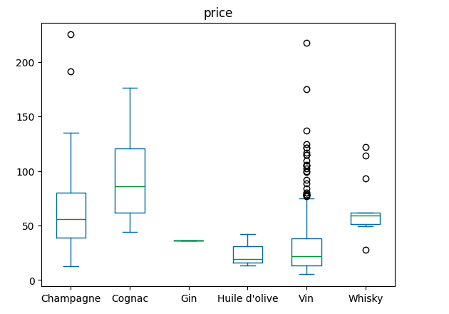
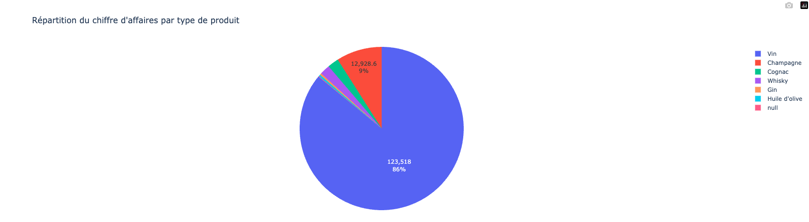
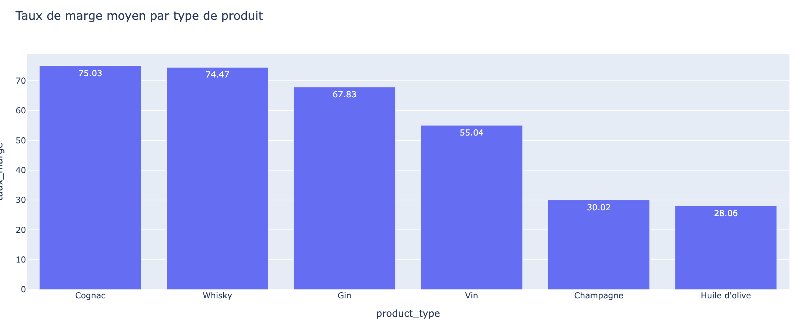
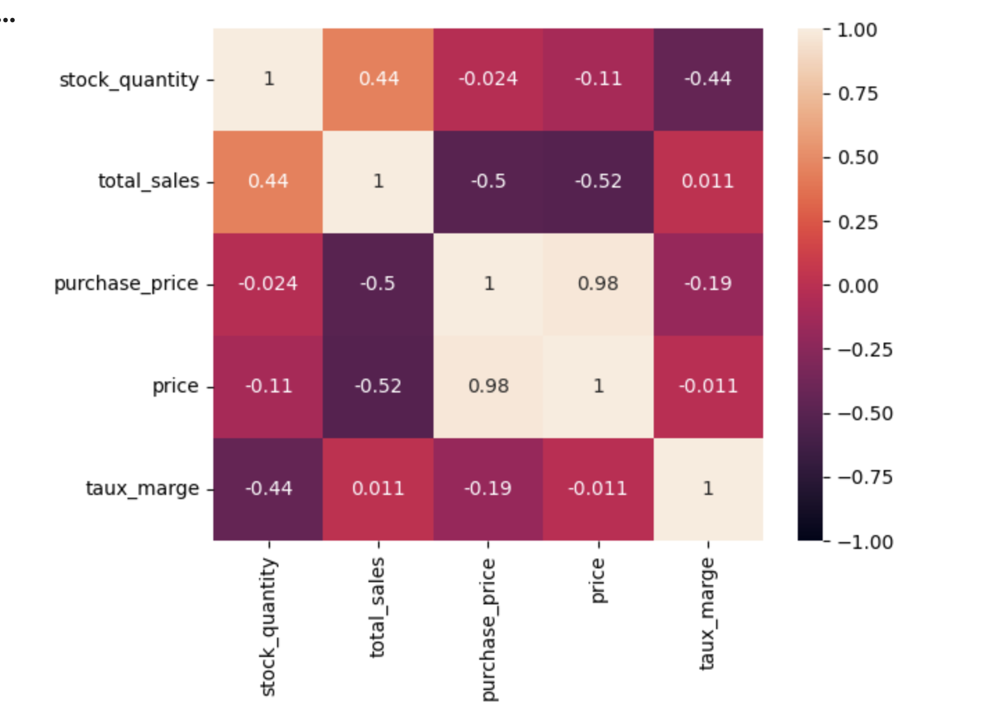

# 📊 Analyse commerciale — BottleNeck

## 🎯 Présentation du projet

Ce projet porte sur l'analyse des données commerciales de **BottleNeck**, une entreprise spécialisée dans la vente de vins et de spiritueux.

L'objectif est de préparer, consolider et analyser plusieurs sources de données afin d'étudier les prix des produits, le chiffre d'affaires, les taux de marge et les relations entre les variables commerciales.

Ce travail s'appuie sur une analyse exploratoire des données (*Exploratory Data Analysis — EDA*) réalisée avec Python.

## 🎯 Objectifs

- Nettoyer et fiabiliser les données.
- Consolider les fichiers ERP, Web et Liaison.
- Étudier la distribution des prix et identifier les valeurs atypiques.
- Analyser les produits selon leur type.
- Comparer les taux de marge moyens par catégorie.
- Étudier les corrélations entre les variables numériques.

## 🛠️ Outils utilisés

- **Python** — analyse et traitement des données.
- **Pandas** — manipulation et consolidation des tableaux.
- **NumPy** — calculs numériques.
- **Matplotlib** — visualisation des données.
- **Seaborn** — visualisations statistiques.
- **Google Colab** — environnement de travail.

---

## 🗂️ 1. Sources de données

L'analyse repose sur trois fichiers complémentaires :

| Fichier | Contenu |
|---|---|
| ERP | Informations produits, prix d'achat, prix de vente, stocks et ventes |
| Web | Informations sur les produits présents sur le site Web |
| Liaison | Correspondances entre les identifiants ERP et les identifiants Web |

### Structure des fichiers

- **ERP** : 29 colonnes et 1 428 lignes.
- **Web** : 6 colonnes et 825 lignes.
- **Liaison** : 2 colonnes et 734 lignes.

Ces fichiers contiennent des informations complémentaires qui doivent être rapprochées pour permettre une analyse commune.

---

## 🔗 2. Construction du jeu de données

Les trois sources ont été rapprochées afin de réunir les informations nécessaires à l'analyse commerciale.

Deux jointures successives ont été réalisées :

1. Rapprochement des données ERP et Liaison à partir de `product_id`.
2. Rapprochement du résultat avec les données Web à partir de l'identifiant correspondant.

Les jointures externes permettent de conserver les références présentes dans les différentes sources et de repérer les problèmes de correspondance.

Cette étape constitue la base des analyses réalisées par la suite.

---

## 🧹 3. Nettoyage et fiabilisation des données

Avant les analyses, plusieurs contrôles ont été effectués afin d'améliorer la qualité des données.

### Données ERP

Les traitements ont porté sur :

- Les valeurs manquantes.
- Les colonnes entièrement vides.
- La colonne de test et la colonne `stock_status_2`.
- Les prix et les stocks négatifs.
- Les incohérences entre les statuts de stock.

### Données Web

Les traitements ont porté sur :

- Les SKU vides.
- Les SKU en doublon.
- Les lignes non exploitables.
- Les lignes correspondant aux pièces jointes.

### Table de liaison

Les contrôles ont porté sur les correspondances entre les identifiants ERP et Web.

Ces vérifications permettent de repérer les problèmes susceptibles d'affecter les résultats de l'analyse.

---

## 📊 4. Analyse des prix

L'analyse de la distribution des prix permet d'étudier les écarts de prix entre les produits et d'identifier les valeurs atypiques (outliers).




Principaux résultats

Prix médian : 23,45 €.

Prix minimum : 5,20 €.

Prix maximum : 225 €.

31 produits atypiques, avec un prix supérieur à 83,70 €.

La moitié des produits présente un prix compris entre 14,05 € et 42,10 €.

Les produits atypiques concernent principalement les vins, suivis du Champagne, du Cognac et du Whisky.

Interprétation:

Les prix sont dispersés différemment selon les catégories. Le graphique met en évidence des valeurs élevées, notamment pour certains vins et champagnes. Ces valeurs atypiques ne sont pas nécessairement des erreurs : elles doivent être interprétées en fonction des caractéristiques des produits.

---

## 💶 5. Répartition du chiffre d'affaires par type de produit

Ce graphique circulaire représente la répartition du chiffre d'affaires entre les différentes catégories de produits. Il a été réalisé avec Plotly à partir de la variable ca_par_article, regroupée selon product_type.



Principaux résultats

Vin : 123 518 €, soit environ 86 % du chiffre d'affaires.

Champagne : 12 928,60 €, soit environ 9 % du chiffre d'affaires.

Les autres catégories représentées sont le Cognac, le Whisky, le Gin et l'huile d'olive.

Interprétation

Le chiffre d'affaires est largement dominé par la catégorie Vin, qui représente environ 86 % du total. Le Champagne arrive en deuxième position avec environ 9 %.

Les autres catégories contribuent beaucoup moins au chiffre d'affaires global. Cette répartition montre que les ventes de BottleNeck reposent principalement sur les vins.


## 💰 6. Analyse du taux de marge

Le graphique compare le taux de marge moyen selon le type de produit.

### Taux de marge moyen par catégorie



### Résultats affichés sur le graphique

| Type de produit | Valeur affichée |
|---|---:|
| Cognac | 75,03 |
| Whisky | 74,47 |
| Gin | 67,83 |
| Vin | 55,04 |
| Champagne | 30,02 |
| Huile d'olive | 28,06 |

Le Cognac et le Whisky présentent les valeurs moyennes les plus élevées sur ce graphique, tandis que le Champagne et l'huile d'olive présentent les valeurs les plus faibles.

Ces résultats permettent de comparer les catégories selon la variable `taux_marge`. L'unité doit être interprétée selon la formule utilisée dans le notebook.

---

## 🔎 7. Analyse des corrélations

La matrice de corrélation permet d'étudier les relations linéaires entre les variables numériques suivantes :

- `stock_quantity`
- `total_sales`
- `purchase_price`
- `price`
- `taux_marge`

### Matrice de corrélation



### Principaux résultats

| Variables comparées | Coefficient de corrélation |
|---|---:|
| Prix d'achat et prix de vente | 0,98 |
| Prix de vente et ventes | -0,52 |
| Stock et ventes | 0,44 |
| Stock et taux de marge | -0,44 |
| Prix de vente et taux de marge | -0,011 |

### Interprétation

Le prix d'achat et le prix de vente présentent une forte corrélation positive dans les données étudiées.

La relation entre le prix de vente et les ventes est négative, tandis que celle entre le stock et les ventes est positive.

Ces coefficients décrivent des associations statistiques. Ils ne suffisent pas, à eux seuls, à établir une relation de causalité entre les variables.

---

## 💡 8. Pistes d'amélioration

À partir des contrôles et des analyses réalisés, plusieurs axes peuvent être envisagés :

- **Fiabiliser les données** : poursuivre les contrôles des valeurs manquantes, des valeurs négatives et des incohérences.
- **Sécuriser les correspondances** : vérifier les références présentes dans une source mais absentes d'une autre.
- **Suivre les prix** : examiner les valeurs atypiques en fonction des produits concernés.
- **Étudier les marges** : approfondir les différences observées entre les catégories.
- **Approfondir l'analyse commerciale** : compléter les indicateurs selon les besoins de suivi de l'activité.

---

## 📁 Organisation du dépôt GitHub

```text
bottleneck-sales-analysis/
│
├── README.md
└── images/
    ├── produits_par_type.png
    ├── distribution_prix.png
    ├── taux_marge.png
    └── correlations.png
```

Les fichiers du dossier `images/` correspondent aux captures intégrées dans ce README. Les noms utilisés dans les liens Markdown doivent correspondre exactement aux noms des fichiers déposés sur GitHub.

Les fichiers de données sources ne sont pas inclus dans cette organisation.

---

## ✅ Conclusion

Ce projet a permis de travailler sur la préparation et la consolidation de plusieurs sources de données commerciales, puis d'étudier les prix, les catégories de produits, les taux de marge et les corrélations entre variables.

Les visualisations facilitent la lecture des résultats et mettent en évidence les différences observées entre les catégories et les variables étudiées.

L'analyse constitue une base pour poursuivre l'étude des données commerciales de BottleNeck et approfondir les indicateurs utiles au suivi de l'activité.
